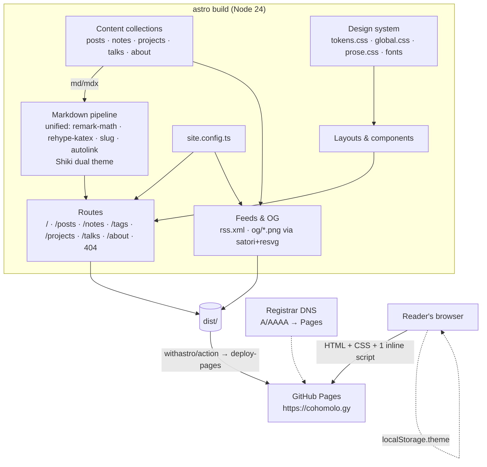

# Architecture — cohomolo-gy

Derived from `architecture.yaml`. Decisions cited from `registry.md`.

## Components

| Component | Owns | Package | Decisions |
| --- | --- | --- | --- |
| Content collections | `src/content/**`, `src/content.config.ts`, `src/lib/content.ts` | p1 (schema), p3 (content) | D-7, D-11 |
| Site configuration | `src/site.config.ts` | p1 | C-5 |
| Markdown pipeline | `astro.config.mjs#markdown` | p1 | D-9, D-14 |
| Design system | `src/styles/**` | p2 | D-10, D-13, D-15 |
| Layouts and components | `src/layouts/**`, `src/components/**` | p2 | D-16 |
| Routes | `src/pages/**/*.astro` | p2 (`/`), p4 (rest) | D-18 |
| Feeds and OG | `src/pages/rss.xml.ts`, `src/pages/og/**`, `src/lib/{feed,og}.ts` | p6 | D-8 |
| Tooling and CI | `scripts/**`, `.github/**` | p1, p5 (dependabot) | C-3 |
| Documentation | `README.md`, `docs/**` | p5 | D-12 |

## Runtime

The deployed site is static HTML, CSS, three self-hosted variable fonts, and one inline script that applies the stored theme before first paint plus one small script for the toggle. No framework runtime, no third-party requests, no cookies. The only client state is `localStorage.theme` (D-10).
