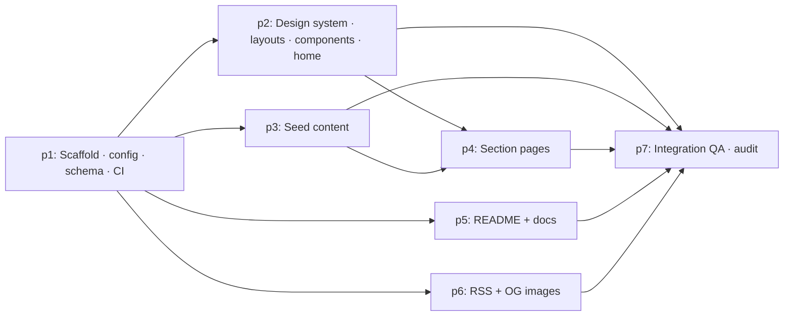

# Work Packages — cohomolo-gy

Derived from `packages.yaml`. Waves: `wave(p) = 1 + max(wave(deps))`.

| Wave | Packages | Isolation | Parallel? |
| ---- | -------- | --------- | --------- |
| 1 | p1 | in-place | — |
| 2 | p2, p3, p5, p6 | worktrees `pkg/p2` `pkg/p3` `pkg/p5` `pkg/p6` | yes — scopes pairwise disjoint (p6 adds dependencies to `package.json`; merged first so the lockfile conflict surface is one branch) |
| 3 | p4 | worktree `pkg/p4` from `main` after p2 + p3 merge | — |
| 4 | p7 | in-place on `main` | — |

Merge order after wave 2 verifies: p6 (touches `package.json`), p2, p3, p5. Rebuild `main` after each merge; wave 3 branches from the rebuilt `main`.

Scope overlap check (same wave): p2 `src/styles/**, src/layouts/**, src/components/**, src/pages/index.astro, src/assets/**, public/favicon.svg` · p3 `src/content/**` · p5 `README.md, docs/**, .github/dependabot.yml` · p6 `src/pages/rss.xml.ts, src/pages/og/**, src/lib/{feed,og}.ts, scripts/og-default.mjs, public/og/**, src/assets/og/**, package*.json` — p2 and p6 both name `src/assets/`; p2 is restricted to `src/assets/` excluding `src/assets/og/`, which is p6's. No other overlap.
